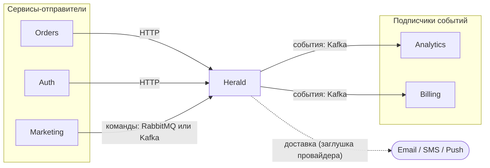
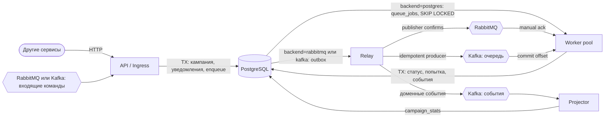
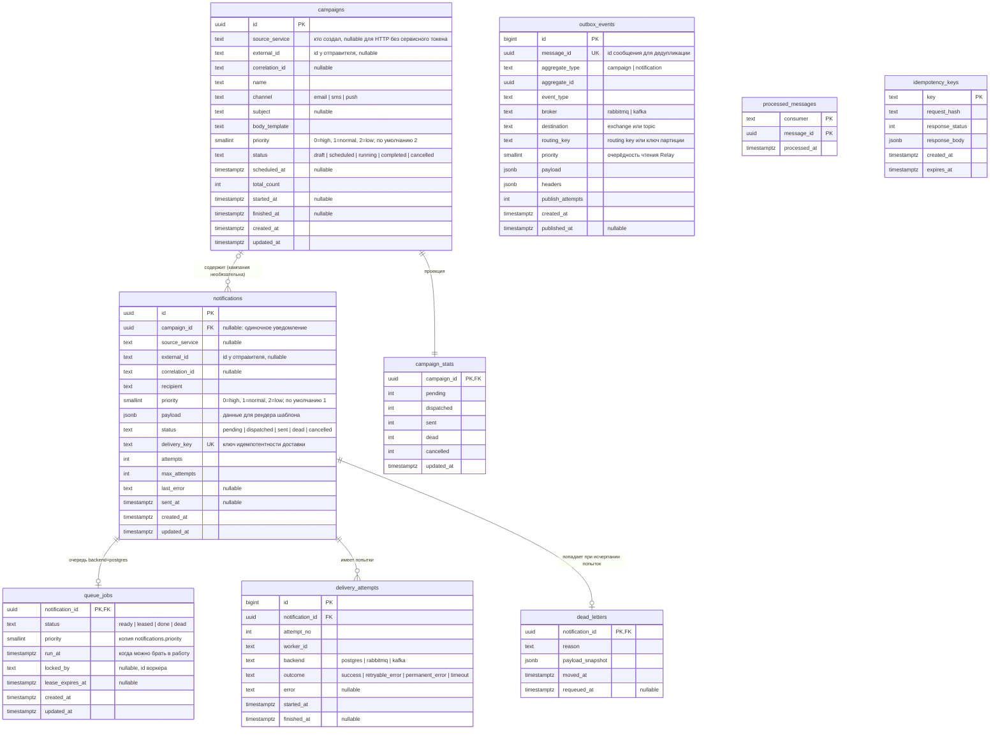

# Herald

**Асинхронная платформа обработки уведомлений на Go.**

Herald — образовательный backend-проект, направленный на изучение Go через разработку асинхронной системы обработки задач, приближенной к production-системам.

Herald задуман как отдельный микросервис большой системы: другие сервисы обращаются к нему по HTTP или отправляют команды через брокер (RabbitMQ или Kafka), а о результатах узнают из публикуемых событий.

Платформа предоставляет HTTP API для управления кампаниями уведомлений и независимые Worker-процессы для их надёжной и конкурентной обработки. Очередь задач реализована тремя взаимозаменяемыми способами: **на PostgreSQL, на RabbitMQ и на Kafka**. Backend выбирается конфигурацией, а все три реализации проходят один и тот же набор контрактных тестов и сравниваются между собой.

Основная цель проекта — изучить Go на практике, решая реальные задачи backend-разработки, а не просто воспроизводя знакомые архитектурные решения и абстракции других языков и фреймворков.

## Цели проекта

- Изучить идиоматичный Go и стандартную библиотеку.
- Разобраться в goroutines, channels и примитивах синхронизации.
- Освоить управление конкурентным выполнением задач.
- Научиться работать с PostgreSQL через `pgx`.
- Реализовать одну очередь задач тремя способами (PostgreSQL, RabbitMQ, Kafka) и сравнить их на практике.
- Понять разницу между очередью задач и журналом событий.
- Спроектировать сервис как часть распределённой системы: контракты, версионирование, идемпотентность входящих команд, владение данными.
- Реализовать надёжную асинхронную обработку задач.
- Изучить управление транзакциями и блокировками.
- Реализовать механизмы отказоустойчивости, повторных попыток и идемпотентности.
- Освоить observability и профилирование производительности.

## Роль в системе

Herald — самостоятельный сервис со своей базой данных и публичными контрактами. Он принимает запросы на отправку уведомлений от других сервисов двумя способами (HTTP и команды через брокер) и сообщает о результатах событиями.



### Интеграционный контракт

| Аспект | Решение |
|---|---|
| Синхронный вход | HTTP API (OpenAPI), ответ `202 Accepted` с идентификатором ресурса |
| Асинхронный вход | Команды в RabbitMQ или Kafka (AsyncAPI), транспорт выбирается `INGRESS_BROKER` |
| Выход | Доменные события в Kafka, подписчики независимы друг от друга |
| Формат сообщений | JSON, общий конверт в стиле CloudEvents (см. «Топология брокеров») |
| Версионирование | Версия в типе сообщения (`campaign.create.v1`) и в пути HTTP (`/v1/...`) |
| Идемпотентность | HTTP: `Idempotency-Key`. Брокер: `message_id` (Inbox) и бизнес-ключ `(source_service, external_id)` |
| Корреляция | `correlation_id` и `traceparent` проходят от входа до событий |
| Приоритеты | Поле `priority` (`high`, `normal`, `low`) в HTTP и в `data` команды. Максимум зависит от `source_service` |
| Владение данными | У сервиса своя БД, другие сервисы читают её только через API и события |
| Аутентификация | Между сервисами — статические сервисные токены (HTTP) и учётные данные брокера. Полноценная авторизация вне объёма |
| Эксплуатация | Конфигурация через переменные окружения, `/healthz` и `/readyz`, graceful shutdown, метрики |

Предварительный набор HTTP-эндпоинтов:
- `POST /v1/campaigns`, `GET /v1/campaigns/{id}`, `POST /v1/campaigns/{id}/cancel`
- `POST /v1/notifications` (одиночное уведомление без кампании), `GET /v1/notifications/{id}`

## Архитектура

Herald состоит из независимо запускаемых приложений: **API**, **Worker**, **Relay** и **Projector**. PostgreSQL остаётся источником истины. Очередь доставки скрыта за небольшим интерфейсом, а конкретный backend выбирается переменной `QUEUE_BACKEND=postgres|rabbitmq|kafka`.



### Интерфейс очереди

Worker не знает, какой backend под ним. Интерфейсы небольшие и описываются на стороне потребителя, как принято в Go. Набросок (будет уточняться):

```go
// Dispatcher ставит сообщения в очередь в рамках транзакции API.
// postgres: INSERT в queue_jobs. rabbitmq и kafka: INSERT в outbox_events.
type Dispatcher interface {
    Enqueue(ctx context.Context, tx pgx.Tx, msgs ...Message) error
}

// Consumer вызывает handler для каждого сообщения и сам отвечает
// за подтверждение, повтор и перевод в DLQ согласно результату.
type Consumer interface {
    Run(ctx context.Context, h Handler) error
}

type Handler func(ctx context.Context, msg Message) Result // Ack | Retry{After} | Dead{Reason}
```

Бизнес-логика (пул workers, идемпотентность, запись попыток и статусов) одна для всех backends. Адаптер отвечает только за доставку сообщений и перевод `Result` в механизм конкретной системы.

### Сравнение backends

| | PostgreSQL | RabbitMQ | Kafka |
|---|---|---|---|
| Что это в роли очереди | Таблица `queue_jobs` | Брокер сообщений | Журнал, используемый как очередь |
| Постановка в очередь | Атомарна с бизнес-данными (одна транзакция) | Через Outbox + Relay | Через Outbox + Relay |
| Захват задач | `FOR UPDATE SKIP LOCKED` + lease | Push с `prefetch`, ack | Pull, партиции назначаются consumer group |
| Подтверждение | `status = done` | `ack` | Commit offset (только непрерывного префикса) |
| Падение воркера | Lease истекает, задача возвращается | Redelivery при закрытии канала | Rebalance, переобработка с последнего commit |
| Отложенный повтор | `run_at` | TTL-очереди + DLX | Retry-топики с ожиданием в consumer |
| Порядок | Не гарантируется | В пределах очереди, ломается при redelivery | В пределах партиции |
| Предел параллелизма | Нагрузка на БД | Число consumers и `prefetch` | Число партиций (учитывая workers внутри партиции) |
| Головная блокировка | Нет | Нет | Есть: медленное сообщение задерживает партицию |
| DLQ | Статус `dead` | Dead-letter exchange | Топик `.dead` |
| Главная сложность | Нагрузка, vacuum, раздувание таблицы | Топология, повторы, надёжность соединений | Commit offset при параллельной обработке, rebalance |

### Распределение ролей Kafka

Kafka используется в двух разных ролях, и это нужно не путать:

1. **Как очередь команд** (backend `kafka`): топик `notifications.dispatch`, consumer group `workers`.
2. **Как журнал событий** (всегда, независимо от backend): топики `campaign.events` и `notification.events` читаются независимыми consumer groups. Это показывает, чем журнал отличается от очереди: событие остаётся в журнале, и его можно перечитать.

### API (Ingress)

Единая точка входа сервиса. Принимает запросы от сервисов двумя способами и от людей через веб-интерфейс. Все три ведут в один и тот же прикладной слой (`internal/campaign`, `internal/notification`):

- **HTTP** (`transport/http`): синхронные запросы, ответ `202 Accepted`. Идемпотентность через `Idempotency-Key`.
- **Брокер** (`transport/amqp` или `transport/kafka`, по `INGRESS_BROKER`): асинхронные команды от других сервисов. Идемпотентность через `message_id` и Inbox. Прямого ответа нет: результат сообщается событиями с тем же `correlation_id`.
- **Web UI** (`transport/web`): серверный рендеринг на `html/template` и htmx для людей, см. «Веб-интерфейс».

Транспортные адаптеры тонкие: разбирают и валидируют входной формат, вызывают use case и отвечают в формате своего транспорта. Бизнес-логики в них нет. Включаются независимо: `INGRESS_HTTP=true|false`, `INGRESS_BROKER=rabbitmq|kafka|none`, `INGRESS_WEB=true|false`.

Отвечает за:
- Управление кампаниями уведомлений.
- Валидацию входящих запросов и команд.
- Создание уведомлений и постановку в очередь в одной транзакции (`Dispatcher.Enqueue`).
- Получение статусов кампаний и уведомлений.
- Предоставление статистики обработки (из проекции `campaign_stats`).

### Worker

Отвечает за:
- Получение сообщений через `Consumer` выбранного backend.
- Конкурентную обработку уведомлений в пуле workers.
- Проверку идемпотентности перед отправкой (`delivery_key`, статус уведомления).
- Обновление статуса, запись попытки и события в одной транзакции.
- Возврат `Result` адаптеру: подтвердить, повторить позже, перевести в DLQ.
- Корректное завершение: остановка приёма сообщений, дообработка активных задач, подтверждение результатов.

### Relay

Реализует паттерн Transactional Outbox. Нужен для backends `rabbitmq` и `kafka`, а также для публикации доменных событий. Отвечает за:
- Чтение неопубликованных записей `outbox_events` (`FOR UPDATE SKIP LOCKED`).
- Публикацию в RabbitMQ или Kafka с подтверждением доставки брокером.
- Отметку `published_at` только после подтверждения.
- Повторные попытки публикации и метрики лага outbox.

Планировщик кампаний (`scheduled_at`) выполняется там же: по наступлении времени кампания переводится в `running` и порождает команды.

### Projector

Читает доменные события из Kafka и обновляет проекцию `campaign_stats`. Дедупликация через Inbox (`processed_messages`).

### Гарантии доставки

Вся система работает по схеме **at-least-once**. Эффект «ровно один раз» обеспечивается идемпотентностью:
- Outbox гарантирует, что команда не потеряется между БД и брокером (но может быть опубликована повторно).
- `notifications.delivery_key` и проверка статуса не дают отправить одно уведомление провайдеру дважды при redelivery в любом backend.
- `processed_messages` (Inbox) не даёт применить одно сообщение дважды: входящую команду в Ingress и событие в Projector. Для входящей команды запись в Inbox, изменение бизнес-данных и запись в outbox происходят в одной транзакции, а брокеру сообщение подтверждается только после коммита.

## Приоритеты

Не все уведомления одинаково срочны: код подтверждения нельзя задерживать из-за рассылки на миллион адресатов. Поэтому у каждого уведомления есть приоритет.

| Приоритет | В БД | Примеры | По умолчанию для |
|---|---|---|---|
| `high` | 0 | коды подтверждения, оповещения безопасности | только по явному запросу |
| `normal` | 1 | транзакционные: статус заказа, чеки | одиночных уведомлений |
| `low` | 2 | маркетинговые рассылки, дайджесты | кампаний |

Правила:
- Приоритет указывается в HTTP-запросе (`priority`) или в `data.priority` команды. Кампания задаёт приоритет всем своим уведомлениям.
- Максимальный приоритет зависит от сервиса-отправителя (`source_service`) и задаётся конфигурацией. Превышение отклоняется: HTTP `403`, а команда уходит в dead. Иначе любой сервис помечал бы всё как `high`.
- Приоритет влияет только на очерёдность и выделяемые ресурсы. Гарантии доставки и идемпотентность одинаковы для всех уровней.

### Изоляция и гарантированная доля, а не строгий приоритет

Строгий приоритет («`low` берётся, только когда `high` пуст») ведёт к голоданию: при постоянном потоке `high` рассылки не двигаются. Поэтому у каждого приоритета своя очередь (или топик), а слоты пула workers распределяются по долям, по умолчанию 60/30/10. Если приоритет не использует свою долю, слоты достаются остальным. В итоге `high` не стоит за backlog рассылки, а `low` не стоит вечно.

### Реализация по backends

| Backend | Как реализуется | Нюансы |
|---|---|---|
| PostgreSQL | Поле `queue_jobs.priority`. Захват отдельным запросом на каждый приоритет, размер пакета пропорционален доле | Один запрос с `ORDER BY priority` привёл бы к голоданию. Индекс `(priority, run_at)` |
| RabbitMQ | Очереди `notifications.<канал>.<приоритет>`, ключ маршрутизации `<канал>.<приоритет>`. Consumer на каждую очередь, `prefetch` по долям | 3 канала × 3 приоритета = 9 очередей, объявляются в цикле. Нативные приоритеты очереди (`x-max-priority`) — предмет эксперимента |
| Kafka | Топики `notifications.dispatch.<приоритет>`. Consumer подписан на все, `pause`/`resume` партиций регулирует долю | Приоритетов внутри топика нет, головная блокировка остаётся в пределах каждого топика |

При повторной попытке сообщение возвращается в очередь своего приоритета. Приоритет хранится и в БД, и в самом сообщении (заголовок).

### Приоритет и Outbox

Relay читает outbox в порядке `id`, поэтому рассылка на миллион адресатов оказалась бы впереди кода подтверждения ещё до попадания в брокер. Против этого две меры:
- В `outbox_events` есть поле `priority`, Relay выбирает записи по `(priority, id)`.
- Планировщик раскрывает кампанию порциями (например, по 1000 уведомлений) по мере освобождения очереди, а не одним махом. Это же ограничивает размер outbox.

### Метрики и цели

Глубина очереди, возраст старейшего сообщения и время ожидания измеряются в разрезе приоритетов. Ориентир для проверки в экспериментах: `high` ждёт в очереди заметно меньше `low` даже при полностью загруженной рассылке, а `low` при этом продолжает идти.

## Топология брокеров

Ресурсы делятся на **публичные** (контракт с другими сервисами) и **внутренние** (детали реализации очереди доставки, снаружи ими пользоваться нельзя).

### Публичный контракт: входящие команды

Команды отправляют другие сервисы. Транспорт выбирается `INGRESS_BROKER`.

| Тип команды | Действие |
|---|---|
| `campaign.create.v1` | Создать кампанию |
| `campaign.cancel.v1` | Отменить кампанию |
| `notification.send.v1` | Отправить одиночное уведомление (без кампании) |

- **RabbitMQ:** exchange `herald.commands` (topic), ключ маршрутизации — тип команды, очередь `herald.commands.inbox` (quorum), невалидные сообщения уходят в `herald.commands.dead`.
- **Kafka:** топик `herald.commands`, ключ — `external_id` (порядок команд по одной сущности), consumer group `herald-ingress`, невалидные сообщения — в `herald.commands.dead`.
- **Ошибки:** невалидная команда сразу уходит в dead (повтор бессмыслен). Временный сбой (например, БД недоступна) приводит к повторной доставке: `nack` с requeue в RabbitMQ, отсутствие commit в Kafka.

#### Формат сообщений

Все команды и события используют общий конверт в стиле CloudEvents:

```json
{
  "id": "0b1f3c52-8a1e-4a57-9a0d-6c3f1d2e9b10",
  "type": "campaign.create.v1",
  "source": "marketing-service",
  "time": "2026-11-06T01:00:00Z",
  "correlation_id": "req-7c2a91",
  "data": {}
}
```

- `id` — идентификатор сообщения, ключ дедупликации (Inbox).
- `type` — тип с версией. Несовместимые изменения выходят как `.v2`, старая версия поддерживается на время миграции потребителей.
- `source` — отправляющий сервис. Вместе с `data.external_id` задаёт бизнес-ключ идемпотентности.
- `correlation_id` — сквозной идентификатор: сохраняется в записях и копируется в события, чтобы отправитель сопоставил результат со своим запросом. Для HTTP берётся из заголовка `X-Correlation-ID`.
- Контекст трассировки (`traceparent`) передаётся в заголовках сообщения.

### Публичный контракт: исходящие события

Доменные события публикуются в Kafka (топики `campaign.events` и `notification.events`, таблица ниже) в том же конверте. Подписчики — другие сервисы и внутренний Projector. Контракты описываются в AsyncAPI.

### RabbitMQ (backend `rabbitmq`)

| Объект | Назначение |
|---|---|
| Exchange `notifications` (direct) | Основной обменник, ключ маршрутизации `<канал>.<приоритет>`, например `sms.high` |
| Queues `notifications.<канал>.<приоритет>` | Основные очереди (quorum queues): по одной на канал (`email`, `sms`, `push`) и приоритет (`high`, `normal`, `low`) |
| Exchange `notifications.retry` | Обменник для повторных попыток |
| Queues `notifications.retry.5s`, `.30s`, `.5m` | Очереди задержки: `x-message-ttl` + dead-letter обратно в `notifications` (ступени backoff) |
| Exchange `notifications.dlx` → Queue `notifications.dead` | Сообщения, которые не удалось обработать |

### Kafka (backend `kafka`, внутренняя очередь доставки)

| Топик | Ключ | Назначение |
|---|---|---|
| `notifications.dispatch.high`, `.normal`, `.low` | `notification_id` | Команды на доставку по приоритетам (consumer group `workers`) |
| `notifications.retry.5s`, `.30s`, `.5m` | `notification_id` | Ступени повторных попыток |
| `notifications.dead` | `notification_id` | Сообщения, исчерпавшие попытки |

Ключ `notification_id` равномерно распределяет нагрузку между партициями. Параллельная обработка внутри партиции требует отслеживания завершённых offsets и commit только непрерывного префикса.

### Kafka: публичные доменные события (всегда)

| Топик | Ключ | События |
|---|---|---|
| `campaign.events` | `campaign_id` | `campaign.created`, `campaign.started`, `campaign.completed`, `campaign.cancelled` |
| `notification.events` | `campaign_id` | `notification.dispatched`, `notification.sent`, `notification.retried`, `notification.dead` |

Ключ `campaign_id` сохраняет порядок событий внутри кампании.

| Consumer group | Назначение |
|---|---|
| `workers` | Обработка внутренних команд доставки (только backend `kafka`) |
| `herald-ingress` | Приём внешних команд (только `INGRESS_BROKER=kafka`) |
| `stats-projector` | Построение `campaign_stats` |
| `audit-logger` | Журнал изменений |

## Модель данных (ERD)



`outbox_events`, `processed_messages` и `idempotency_keys` — служебные таблицы без внешних ключей. Связь с доменными таблицами логическая (`aggregate_type` + `aggregate_id`).

### Ключевые проектные решения

- **Очередь — подключаемый backend.** Состояние доставки (`notifications`) отделено от механики очереди. Поэтому при `rabbitmq` и `kafka` таблица `queue_jobs` просто не используется, а при `postgres` не используется очередь брокера.
- **`queue_jobs` отдельно от `notifications`.** Связь 1:1 оправдана: поля блокировки и lease нужны только одному из трёх backends и не должны загрязнять доменную таблицу. Частые обновления `queue_jobs` не раздувают `notifications`.
- **Единая модель повторов.** `notifications.attempts` и `max_attempts` — общее состояние, независимо от backend. Решение о повторе принимает бизнес-логика Worker, а адаптер реализует задержку (`run_at`, TTL-очередь, retry-топик).
- **Transactional Outbox для брокеров.** Изменение состояния и запись в `outbox_events` происходят в одной транзакции. Для backend `postgres` outbox не нужен: сама очередь находится в той же базе, и постановка в неё атомарна.
- **Relay использует `FOR UPDATE SKIP LOCKED`.** Несколько экземпляров Relay безопасно читают одну таблицу. Тот же приём применяется в backend `postgres` для захвата задач.
- **Lease вместо долгих блокировок (backend `postgres`).** Воркер ставит `locked_by` и `lease_expires_at`, не держит транзакцию во время отправки. Строки с истёкшим lease возвращаются в `ready`.
- **Идемпотентность на трёх уровнях.** `idempotency_keys` — повторные HTTP-запросы. `delivery_key` — повторная доставка провайдеру. `processed_messages` (Inbox) — повторное применение сообщений: входящих команд и событий.
- **Бизнес-ключ от отправителя.** Пара `(source_service, external_id)` уникальна в `campaigns` и `notifications`. Она защищает от дублей, даже если отправитель повторил команду с новым `message_id` (например, после перезапуска).
- **Одиночные уведомления.** `notifications.campaign_id` необязателен: транзакционные уведомления («код подтверждения», «заказ отправлен») не принадлежат кампании. Проекция `campaign_stats` строится только для кампаний.
- **Сервис владеет своими данными.** Другие сервисы не читают его БД, взаимодействие идёт только через HTTP и брокеры по описанным контрактам.
- **Приоритет копируется, а не вычисляется.** Источник истины — `notifications.priority`. В `queue_jobs`, `outbox_events` и заголовок сообщения значение копируется при постановке в очередь, чтобы выбор по приоритету не требовал JOIN.
- **`delivery_attempts` — журнал, а не состояние.** Таблица только дополняется, поле `backend` позволяет сравнивать поведение backends по одним и тем же метрикам.
- **`dead_letters` отдельно от статуса `dead`.** Хранит причину, снимок данных и время ручного возврата в очередь. Единая точка для всех трёх backends.
- **`campaign_stats` — read-model.** Обновляется Projector'ом из событий Kafka, а не агрегацией по `notifications`. Это eventual consistency: статистика может отставать от реального состояния.

### Индексы

| Таблица | Индекс | Назначение |
|---|---|---|
| `queue_jobs` | partial `(priority, run_at) WHERE status = 'ready'` | выборка задач воркером по приоритетам |
| `queue_jobs` | partial `(lease_expires_at) WHERE status = 'leased'` | поиск зависших задач |
| `outbox_events` | partial `(priority, id) WHERE published_at IS NULL` | выборка неопубликованных событий Relay |
| `outbox_events` | unique `(message_id)` | дедупликация сообщений |
| `notifications` | `(campaign_id, status)` | прогресс кампании, массовая отмена |
| `notifications` | unique `(delivery_key)` | защита от дублей доставки |
| `campaigns` | unique `(source_service, external_id)` WHERE `external_id IS NOT NULL` | идемпотентное создание кампании |
| `notifications` | unique `(source_service, external_id)` WHERE `external_id IS NOT NULL` | идемпотентная одиночная отправка |
| `delivery_attempts` | `(notification_id, attempt_no)` | история попыток |
| `processed_messages` | PK `(consumer, message_id)` | Inbox-дедупликация |
| `idempotency_keys` | `(expires_at)` | очистка устаревших ключей |

## Веб-интерфейс

У Herald есть простой веб-интерфейс для разработчика и оператора. Без SPA и сборки фронтенда: страницы рендерятся на сервере через `html/template`, а частичные обновления делает htmx (один файл, лежит в репозитории, без CDN и npm). Шаблоны и статика встраиваются в бинарник через `go:embed`.

- **Где работает.** В процессе API как ещё один транспортный адаптер (`transport/web`, путь `/ui/`), включается `INGRESS_WEB=true`. Вызывает те же use cases, что и HTTP-адаптер и обработчик команд.
- **Страницы:** список кампаний (создание, редактирование черновика, отмена, удаление), карточка кампании с прогрессом, список уведомлений с фильтрами по статусу, приоритету и каналу, dead letters с возвратом в очередь.
- **Как устроены.** Обработчики возвращают HTML-фрагменты, а не JSON. Прогресс обновляется опросом (`hx-trigger="every 2s"`), формы отправляются через `hx-post` и заменяют свой блок ответом сервера (`hx-target`, `hx-swap`).
- **Ограничения.** Авторизации нет, интерфейс только для разработки и по умолчанию слушает localhost.

## Внешние провайдеры (заглушки)

Herald не отправляет сообщения настоящим провайдерам. Worker работает с небольшим интерфейсом `Sender` (по одной реализации на канал), а адреса задаются конфигурацией. Поэтому заглушку можно позже заменить настоящим провайдером без изменения Worker.

| Канал | Заглушка | Протокол | Адрес для приложения (с хоста) | Интерфейс |
|---|---|---|---|---|
| Email | Mailpit | SMTP | `SMTP_ADDR=localhost:1025` | http://localhost:8025 |
| SMS | `providersim` | HTTP `POST /sms/send` | `SMS_URL=http://localhost:8090/sms/send` | http://localhost:8090 |
| Push | `providersim` | HTTP `POST /push/send` | `PUSH_URL=http://localhost:8090/push/send` | http://localhost:8090 |

Запуск: `docker compose --profile providers up -d` (из каталога `deployments`).

`providersim` — небольшой самописный HTTP-сервер на Go (`deployments/providersim`, отдельный модуль без зависимостей). Интерфейс сделан на том же стеке, что и интерфейс Herald: `html/template` + htmx. На главной странице:
- счётчики запросов и ответов по каналам и список полученных сообщений (обновляется опросом);
- режим отказов: задержка и доли ответов `500`, `429` (с `Retry-After`) и зависших запросов, плюс готовые пресеты («Нестабильный», «Лимит запросов», «Недоступен» и другие);
- тестовая отправка из формы, в том числе с `Idempotency-Key`;
- кнопка очистки сообщений.

Поведение, на которое опираются тесты:
- Повторный `Idempotency-Key` возвращает `duplicate: true` и не создаёт нового сообщения. Так проверяется `delivery_key`.
- Получатель или токен со словом `invalid` всегда даёт постоянную ошибку (SMS: `422`, push: `404`), а пустые обязательные поля — `400`.
- Для скриптов и нагрузочных сценариев есть JSON API: `GET /admin/state`, `PUT /admin/config/{sms|push}`, `DELETE /admin/messages`.

Классификация ответов в Worker: сетевые ошибки, таймауты, `5xx` и `429` считаются временными (повтор с учётом `Retry-After`), остальные `4xx` — постоянными (сразу в dead, без повторов).

## Технологический стек

| Компонент | Технология |
|---|---|
| Язык | Go |
| HTTP Server и Router | `net/http` (`http.ServeMux` с методами и параметрами пути, Go 1.22+) |
| Database | PostgreSQL |
| PostgreSQL Driver | `pgx` |
| SQL | Native SQL / sqlc |
| Migrations | golang-migrate |
| Очередь backend 1 | PostgreSQL (`queue_jobs`) |
| Очередь backend 2 | RabbitMQ, клиент `amqp091-go` |
| Очередь backend 3 и события | Kafka (KRaft, без ZooKeeper), клиент `franz-go` |
| Logging | `log/slog` |
| Metrics | Prometheus |
| Tracing | OpenTelemetry |
| Testing | Go testing, testcontainers-go |
| Containers | Docker Compose (профили: `rabbitmq`, `tools`, `providers`) |
| Контракты | OpenAPI (HTTP), AsyncAPI (команды и события) |
| UI | `html/template` + htmx, без сборки фронтенда |

Основной приоритет — стандартная библиотека Go и идиоматичные подходы языка без избыточных зависимостей и абстракций. Для Kafka выбор клиента (`franz-go`, `segmentio/kafka-go`, `sarama`) подтверждается на старте Phase 6 небольшим сравнением.

## Основные возможности

### Управление кампаниями
- Приём запросов по HTTP и команд через брокер (RabbitMQ или Kafka) с одинаковой семантикой.
- Отправка одиночных уведомлений вне кампаний.
- Простой веб-интерфейс для управления кампаниями и просмотра уведомлений (`html/template` + htmx).
- Создание и управление кампаниями уведомлений.
- Планирование отправки.
- Отслеживание прогресса обработки.
- Отмена ожидающих уведомлений.
- Получение статистики.

### Асинхронная обработка
- Три взаимозаменяемых backend очереди (PostgreSQL, RabbitMQ, Kafka).
- Приоритеты `high` / `normal` / `low` с гарантированной долей ресурсов, без голодания.
- Единый интерфейс `Dispatcher` / `Consumer` и общий набор контрактных тестов.
- Transactional Outbox и Relay для брокеров.
- Конкурентный Worker Pool.
- Настраиваемое количество workers, `prefetch` и размер пакета.
- Контроль параллелизма.
- Graceful shutdown.

### Надёжность
- Повторные попытки с экспоненциальным backoff и jitter в каждом backend.
- Настраиваемая политика повторных попыток.
- Dead Letter Queue для каждого backend и таблица `dead_letters`.
- Защита от повторной обработки (`delivery_key`, Inbox).
- Lease и автоматическое восстановление зависших заданий (backend `postgres`).
- Publisher confirms, manual ack и commit offset после обработки.
- Переподключение к брокерам при обрыве соединения.

### События и проекции
- Доменные события в Kafka.
- Consumer groups и параллельное чтение партиций.
- Проекция статистики кампаний.
- Возможность перестроить проекцию перемоткой offset.

### Observability
- Структурированное логирование.
- Метрики Prometheus одинакового состава для всех backends (глубина очереди, возраст старейшего сообщения, время обработки, повторы) в разрезе приоритетов.
- Лаг outbox и consumer lag.
- Distributed tracing со сквозной передачей контекста через заголовки сообщений.
- Health и readiness endpoints.
- Профилирование через `pprof`.

## Структура проекта

```text
herald/
├── cmd/
│   ├── api/
│   │   └── main.go
│   ├── worker/
│   │   └── main.go
│   ├── relay/
│   │   └── main.go
│   ├── projector/
│   │   └── main.go
│   └── producer/               # симулятор других сервисов: шлёт команды по HTTP, RabbitMQ и Kafka
│       └── main.go
├── internal/
│   ├── campaign/
│   ├── notification/
│   ├── queue/
│   │   ├── queue.go            # Message, Result, Dispatcher, Consumer
│   │   ├── postgres/
│   │   ├── rabbitmq/
│   │   ├── kafka/
│   │   └── queuetest/          # контрактные тесты для всех backends
│   ├── outbox/
│   ├── events/
│   ├── worker/
│   ├── projection/
│   ├── database/
│   ├── config/
│   ├── observability/
│   └── transport/
│       ├── http/
│       ├── web/                # UI: html/template + htmx (templates/, static/)
│       ├── amqp/               # входящие команды из RabbitMQ
│       └── kafka/              # входящие команды из Kafka
├── migrations/
├── deployments/
│   ├── docker-compose.yml      # postgres и kafka всегда, остальное по профилям
│   ├── .env.example            # шаблон настроек, копируется в .env (не коммитится)
│   └── providersim/            # заглушка SMS и push (Go, html/template + htmx)
├── api/
│   ├── openapi.yaml            # HTTP-контракт
│   └── asyncapi.yaml           # команды и события
├── go.mod
└── README.md
```

Структура предварительная и может изменяться по мере развития проекта.

## План разработки

### Phase 1 — Основы Go
- [ ] Инициализация проекта.
- [ ] Управление конфигурацией.
- [ ] HTTP Server.
- [ ] Подключение PostgreSQL, миграции.
- [ ] Базовые CRUD-операции для кампаний.
- [ ] Веб-интерфейс кампаний на `html/template` + htmx: список, создание, редактирование, отмена.
- [ ] Структурированное логирование.
- [ ] Docker Compose: PostgreSQL, RabbitMQ, Kafka.
- [ ] Контракты: `openapi.yaml`, `asyncapi.yaml`, формат конверта сообщений.
- [ ] Симулятор `cmd/producer` для отправки команд.

### Phase 2 — Concurrency
- [ ] Goroutines и channels.
- [ ] Реализация Worker Pool (на заглушке источника задач).
- [ ] Ограничение concurrency.
- [ ] Context cancellation.
- [ ] Graceful shutdown.

### Phase 3 — Очередь на PostgreSQL (backend 1)
- [ ] Интерфейсы `Dispatcher`, `Consumer`, типы `Message` и `Result`.
- [ ] Таблица `queue_jobs`, постановка в очередь в транзакции API.
- [ ] Захват задач: `FOR UPDATE SKIP LOCKED`, пакетное получение.
- [ ] Приоритеты: отдельный захват по уровням, распределение слотов пула по долям.
- [ ] Lease и восстановление зависших заданий.
- [ ] Интерфейс `Sender`: email по SMTP (Mailpit), SMS и push по HTTP (`providersim`).
- [ ] Worker: обработка уведомлений через `Sender`.
- [ ] Контрактные тесты `queuetest`.

### Phase 4 — Reliability
- [ ] Политика повторных попыток, exponential backoff и jitter.
- [ ] Dead Letter Queue и таблица `dead_letters`.
- [ ] Интерфейс: просмотр dead letters и возврат в очередь.
- [ ] `delivery_key` и идемпотентность API (`Idempotency-Key`).
- [ ] Бизнес-ключ `(source_service, external_id)` и сквозной `correlation_id`.
- [ ] Тесты на сбои: падение воркера между отправкой и подтверждением.

### Phase 5 — RabbitMQ (backend 2)
- [ ] Outbox и Relay: `SKIP LOCKED`, publisher confirms.
- [ ] Топология: exchanges, quorum queues по `<канал>.<приоритет>`, retry-очереди, DLX.
- [ ] Outbox: выборка по `(priority, id)`, порционное раскрытие кампаний.
- [ ] Consumer: `prefetch`, manual ack, переподключение.
- [ ] Приём входящих команд из RabbitMQ (`transport/amqp`): Inbox в одной транзакции с изменением данных, невалидные в dead.
- [ ] Прохождение контрактных тестов.

### Phase 6 — Kafka (backend 3) и события
- [ ] Выбор клиента, топики, ключи, партиции.
- [ ] Consumer group `workers`: параллельная обработка, commit непрерывного префикса offsets.
- [ ] Retry-топики и `notifications.dead`.
- [ ] Топики по приоритетам, `pause`/`resume` партиций для распределения долей.
- [ ] Rebalance и graceful shutdown consumer'а.
- [ ] Публикация доменных событий через outbox.
- [ ] Projector, проекция `campaign_stats`, Inbox (`processed_messages`).
- [ ] Перестроение проекции перемоткой offset.
- [ ] Приём входящих команд из Kafka (`transport/kafka`): commit после коммита транзакции, невалидные в dead.
- [ ] Прохождение контрактных тестов.

### Phase 7 — Observability
- [ ] Prometheus metrics, одинаковые для всех backends.
- [ ] OpenTelemetry tracing через границы брокеров.
- [ ] Runtime profiling.
- [ ] Мониторинг лага outbox, глубины очередей и consumer lag.

### Phase 8 — Сравнение и Advanced Go
- [ ] Единый нагрузочный сценарий для трёх backends.
- [ ] Проверка приоритетов: `high` не ждёт за backlog `low`, `low` не голодает.
- [ ] Сравнение пропускной способности, задержки, поведения при сбоях.
- [ ] Race detection.
- [ ] Benchmarking.
- [ ] Анализ выделения памяти.
- [ ] Изучение Garbage Collector.
- [ ] Сравнение различных моделей конкурентности.

## Запуск проекта

На текущем этапе инструкции по запуску ещё не доступны, поскольку реализация проекта не начата.

Инструкции будут добавлены после реализации базовой инфраструктуры и первых компонентов приложения.

## Тестирование

В рамках проекта планируется использовать следующие инструменты:

```bash
# Запуск всех тестов
go test ./...

# Проверка конкурентного доступа
go test -race ./...

# Запуск benchmark-тестов
go test -bench=. ./...

# Статический анализ
go vet ./...
```

Планируемые категории тестирования:
- Unit tests.
- Контрактные тесты очереди: один набор сценариев (ack, повтор, DLQ, redelivery при падении, graceful shutdown, приоритеты), который проходит каждый backend.
- Контрактные тесты сообщений: конверты команд и событий проверяются по схемам AsyncAPI.
- Integration tests с PostgreSQL, RabbitMQ и Kafka (testcontainers).
- HTTP handler tests.
- Worker Pool tests.
- Concurrency tests.
- Retry и recovery tests.
- Chaos-сценарии: падение воркера, Relay и брокера в середине обработки.
- Load tests.

## Принципы разработки

- **Simplicity:** простота важнее избыточных абстракций. Интерфейс очереди остаётся минимальным.
- **Explicitness:** зависимости, ошибки и поток выполнения должны быть очевидными.
- **Composition:** предпочтение композиции перед сложными иерархиями.
- **Concurrency Safety:** явное управление общим состоянием и жизненным циклом goroutines.
- **Reliability:** система должна учитывать сбои, повторные попытки и прерывания процессов.
- **Observability:** поведение системы должно быть измеримым и диагностируемым.
- **Pragmatism:** оптимизация должна основываться на измерениях, а не предположениях.

## Подход к обучению

Herald не является попыткой перенести NestJS-архитектуру на Go.

Это возможность изучить другой подход к backend-разработке и понять, как Go решает привычные инженерные задачи.

Каждая существенная функциональность должна включать:

1. Практическую реализацию.
2. Автоматизированные тесты.
3. Изучение используемых механизмов Go.
4. Рассмотрение альтернативных решений.
5. Benchmark-тесты там, где важна производительность.

## Что не входит в первоначальный объём проекта

Чтобы сосредоточиться на изучении Go и основных принципах backend-разработки, следующие возможности отложены:

- Kubernetes.
- Остальные сервисы большой системы: их роль играет симулятор `cmd/producer`. Сам Herald остаётся одним сервисом из нескольких процессов в одном репозитории.
- API gateway, service discovery, service mesh.
- Реальные интеграции с провайдерами email, SMS и push (вместо них Mailpit и `providersim`).
- WebSocket.
- SPA и сборка фронтенда (интерфейс делается на `html/template` + htmx).
- Multi-tenancy.
- Сложная система авторизации.
- Schema Registry и Avro/Protobuf для Kafka (на старте события в JSON).
- Переключение backend на лету без перезапуска и миграция сообщений между backends.

Они могут быть добавлены после завершения основных этапов.

## Эксперименты

После реализации основной функциональности планируется провести ряд технических экспериментов:

- Сравнение трёх backends очереди: пропускная способность, задержка, нагрузка на БД, поведение при падении воркера и брокера.
- Предел очереди на PostgreSQL: при какой нагрузке `SKIP LOCKED` и vacuum становятся узким местом.
- Приоритеты: строгий приоритет против распределения по долям (голодание `low`, задержка `high`).
- Приоритеты в RabbitMQ: отдельные очереди против нативных приоритетов очереди.
- Приоритеты в Kafka: влияние `pause`/`resume` партиций на задержку и пропускную способность.
- Retry в RabbitMQ: TTL-очереди против плагина delayed-message-exchange.
- Влияние `prefetch` и количества workers на пропускную способность.
- Kafka как очередь: головная блокировка, число партиций, параллельная обработка внутри партиции.
- Поведение consumer group при rebalance и падении consumer'а.
- Сравнение Kafka-клиентов для Go.
- Сравнение Worker Pool на channels и `sync.WaitGroup` с semaphore.
- Сравнение обработки одиночных заданий и batch processing.
- Исследование Garbage Collector при массовой обработке.
- Изучение стоимости создания goroutines.
- Исследование планировщика Go.
- Сравнение `pgx` и `database/sql`.